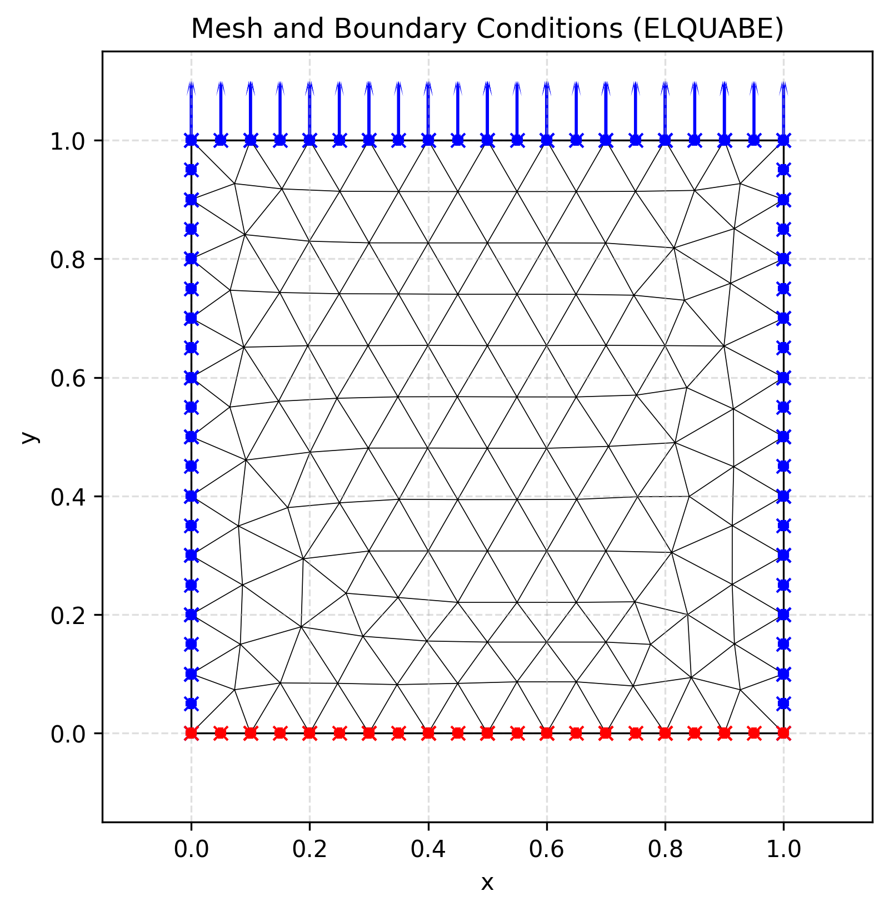
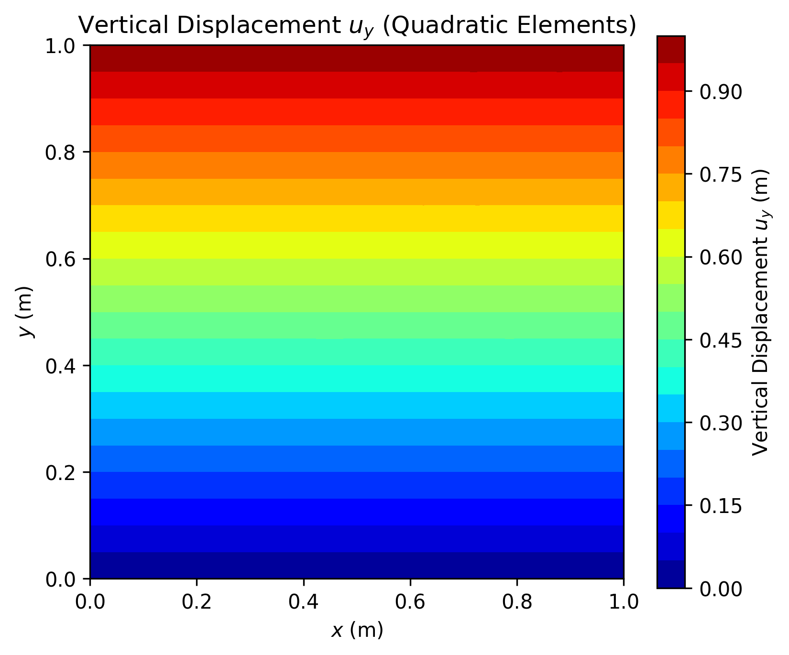
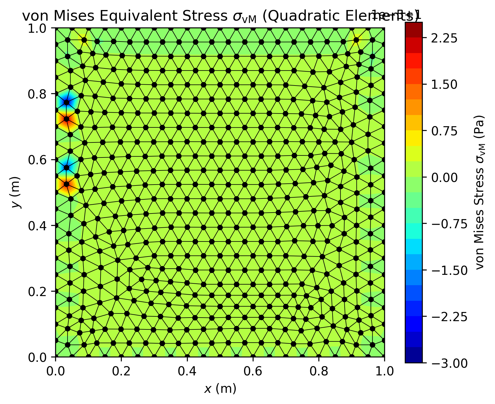
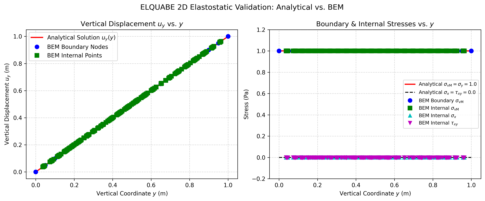

# Modernized BEM for Elastostatics (ELQUABE)

This repository contains a modernized Fortran 90 implementation of the **ELQUABE** program, originally developed by Brebbia and Dominguez in their classic textbook *Boundary Elements: An Introductory Course*.

The program uses the **Boundary Element Method (BEM)** with quadratic boundary elements to solve 2D (plane) elastostatic problems.

## 🚀 Modernization Features

The original Fortran 77 codebase has been fully refactored to meet modern high-performance computing standards:

1. **Free-Form & Modular Architecture**: The monolithic code was split into clean F90 modules (`data_mod`, `io_mod`, `assembly_mod`, `solver_mod`), eliminating all legacy `COMMON` blocks, arithmetic `IF`s, and computed `GOTO`s, while enabling strict compiler type checking (`IMPLICIT NONE`).
2. **Dynamic Memory Allocation & Explicit Connectivity**: Static limitations (e.g., fixed dimensions `NX=100`, `NX1=150` and single-loop implicit node numbering) were completely removed. The program now reads the exact number of boundary elements, internal points, and the **element connectivity matrix** (`CONEC`) from the input file, dynamically allocating arrays (`ALLOCATABLE`) and enabling the modeling of multiply-connected domains (e.g., plates with holes or internal cavities).
3. **OpenMP Parallelization & Loop/Quadrature Optimization**: The heavy matrix integration and assembly routines (`GHMATEQ` and `INTEREQ`) that build the $G$ and $H$ matrices and evaluate internal points are parallelized with OpenMP and optimized to eliminate redundant calculations:
   - Quadratic shape functions at all standard Gauss points (`SF_G`) and logarithmic Gauss points (`SF_GL`) are precomputed once into matrices before the integration loops and passed into `EXTINEQ`, `LOCINEQ`, and `SIGMAEQ`.
   - In `GHMATEQ`, the assembly loops are ordered with the **boundary element loop on the outside** and the **collocation (source) point loop on the inside**, allowing the element Jacobians (`XJA`) and outward unit normal vectors (`ETA1`, `ETA2`) to be computed only once per element instead of being recalculated for every collocation point.
4. **LAPACK Solver Integration**: The native manual Gaussian elimination solver (`SLNPD`) was replaced with LAPACK's highly optimized `DGESV` (Double-precision Real General Linear Equation Solver) for superior performance and numerical stability in large systems.
5. **Double Precision Upgrade**: The solver inherently enforces **64-bit double precision** using compiler flags (`-fdefault-real-8`), promoting all `REAL` variables to `REAL*8` (`real64`), guaranteeing highly precise numerical integration.
6. **Near-Singularity Treatment via $\sinh$ Transformation**: For collocation or internal points located very close to a boundary element (where the source point does not belong to the element), `EXTINEQ` and `SIGMAEQ` apply the nonlinear hyperbolic sine ($\sinh$) coordinate transformation (`SINHTRANS`, Johnston & Elliott, 2005), clustering Gauss points around the projection of the source point and eliminating near-singularity errors on refined meshes.
7. **Boundary Stress & von Mises Recovery**: The original `ELQUABE` code only evaluated the full stress tensor at internal points (`SIGMAEQ`), outputting only tractions on the boundary. The modernized solver implements `BOUND_STRESS` and `CALC_DFFORMA` to recover the complete Cauchy stress tensor ($\sigma_x, \tau_{xy}, \sigma_y$) and the **von Mises equivalent stress** ($\sigma_{\text{vM}}$) at all boundary nodes using tangential derivatives of the quadratic shape functions and Hooke's law in local normal–tangential coordinates.
8. **Python Pre/Post-Processing & VTK Export**: Python scripts (`input_data.py`, `preproc.py`, and `posproc.py`) integrate with Gmsh (`meshio`), plot geometries and boundary conditions (`geometry.png`), validate numerical results against analytical elastostatic solutions, export `.vtk` files for ParaView, and generate 2D domain contour maps of displacements and von Mises stresses.
9. **Colab Ready**: A self-contained Jupyter Notebook (`Run_elquabe_on_Colab.ipynb`) is included to run the entire pipeline in Google Colab.

## 📂 Project Structure

### Fortran Source Code
- `main.f90`: Main program entry point.
- `data_mod.f90`: Global variable declarations, element connectivity matrix (`CONEC`), and dynamic array allocations (`allocate_arrays`, `deallocate_arrays`).
- `assembly_mod.f90`: Connectivity-driven BEM influence matrices integration, assembly, and boundary/internal stress recovery (`GHMATEQ`, `EXTINEQ`, `LOCINEQ`, `INTEREQ`, `BOUND_STRESS`, `CALC_DFFORMA`, `SIGMAEQ`).
- `io_mod.f90`: Input/Output routines (`INPUTEQ`, `OUTPTEQ`), reading boundary node coordinates, element connectivity (`CONEC`), boundary conditions, and internal points.
- `solver_mod.f90`: System of equations solver wrapper for LAPACK (`DGESV`).
- `elquabe.for`: Original legacy Fortran 77 source code kept for reference.

### Output Data Files
- `eq12cb.out`: Formatted general report (mesh, boundary conditions, boundary displacements, tractions, boundary stresses, and internal displacements/stresses).
- `dpbou.dat` / `dpint.dat`: Boundary and internal nodal displacements (`u_x`, `u_y`, `|u|`).
- `stbou.dat` / `stint.dat`: Boundary and internal nodal stresses in 4 columns (`sigma_x`, `tau_xy`, `sigma_y`, `sigma_vm`).

### Python Tools, Mesh & Validation
- `placa.geo` / `placa.msh`: Gmsh geometry and quadratic mesh (`line3` boundary elements and `triangle6` domain elements).
- `preproc.py`: Reads Gmsh `.msh` files via `meshio`, plots the boundary element mesh (`geometry.png`), and exports the solver input file (`eq12cb.dat`).
- `posproc.py`: Reads the exported boundary/internal displacements and stresses, validates the numerical BEM solution against analytical plane elasticity solutions (`result_plot.png`), exports VTK data (`resultado_elquabe.vtk`), and plots 2D domain contour maps of vertical displacement (`displacement_map.png`) and von Mises equivalent stress (`von_mises_map.png`).
- `Run_elquabe_on_Colab.ipynb`: Google Colab notebook for running the preprocessing, compiling the BEM code, and executing the analytical validation and contour plotting entirely in the cloud.

### Build Scripts
- `Makefile` / `build.bat`: Build scripts for Linux and Windows/MSYS2 environments.

## ⚙️ Compilation & Build

### Requirements
- **GFortran** (GCC)
- **LAPACK & BLAS** libraries
- **OpenMP** (`libgomp`)

If you are using Windows with MSYS2 (`UCRT64`), ensure the dependencies are installed:
```bash
pacman -S mingw-w64-ucrt-x86_64-gcc-fortran mingw-w64-ucrt-x86_64-lapack mingw-w64-ucrt-x86_64-make
```

### Building the Executable
Navigate to the repository folder and run:
```bash
make
```
*(Or `mingw32-make` / `.\build.bat` on Windows)*. This invokes `gfortran` with `-fopenmp -O3 -fdefault-real-8 -Wall -Wextra` and links against `-llapack -lblas` to produce `elquabe_modern.exe`.

## 🏃 Usage & Validation Pipeline

1. **Preprocessing**: Create your geometry and quadratic mesh using Gmsh (`gmsh -2 placa.geo -o placa.msh -order 2`), then run the Python preprocessor to generate the standard input file:
   ```bash
   python preproc.py
   ```
   *Outputs: `eq12cb.dat` and `geometry.png`.*

2. **Execution**: Run the Fortran BEM solver:
   ```bash
   ./elquabe_modern.exe
   ```
   The solver reads `eq12cb.dat`, computes the elastostatic influence matrices across multiple threads, solves the linear system via LAPACK (`DGESV`), recovers boundary and internal stresses, and writes `eq12cb.out`, `dpbou.dat`, `dpint.dat`, `stbou.dat`, and `stint.dat`.

3. **Post-Processing & Validation**: Compare the BEM numerical results with the analytical solution for 2D plane elasticity and generate contour maps:
   ```bash
   python posproc.py
   ```
   *Outputs: `result_plot.png`, `displacement_map.png`, `von_mises_map.png`, and `resultado_elquabe.vtk`.*

## 📊 Sample Results (Square Plate under Uniaxial Tension)

| Mesh & Internal Points | Vertical Displacement $u_y$ | von Mises Stress $\sigma_{\text{vM}}$ |
| :---: | :---: | :---: |
|  |  |  |



## 📖 References

* **Brebbia, C. A., & Dominguez, J.** (1992). *Boundary Elements: An Introductory Course*. Computational Mechanics Publications & McGraw-Hill.
