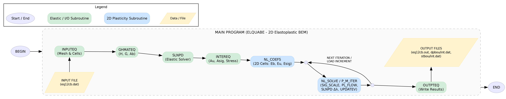
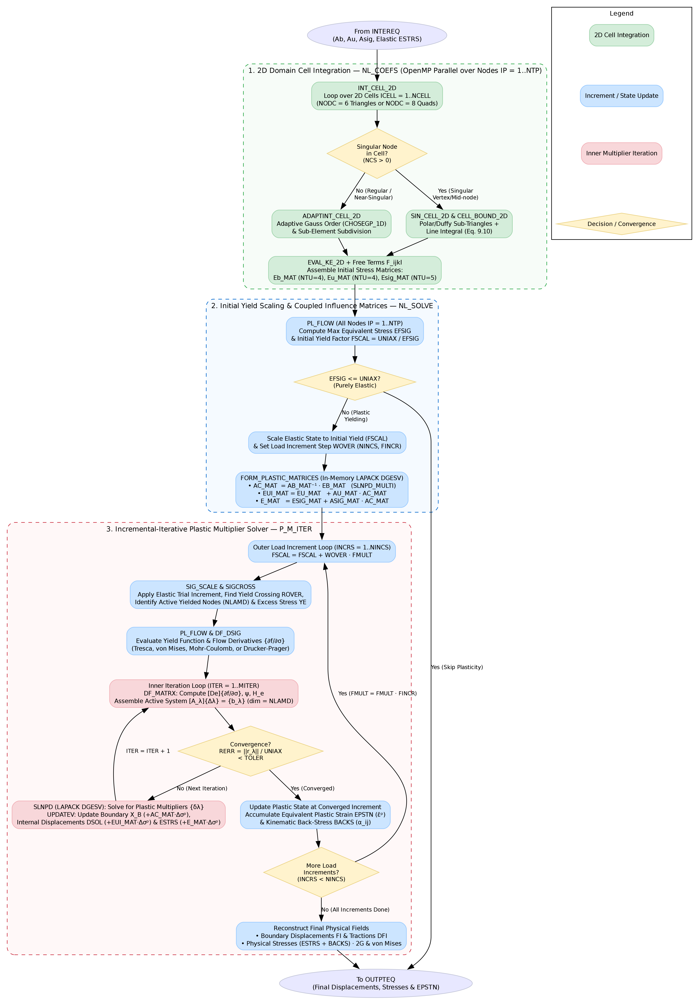
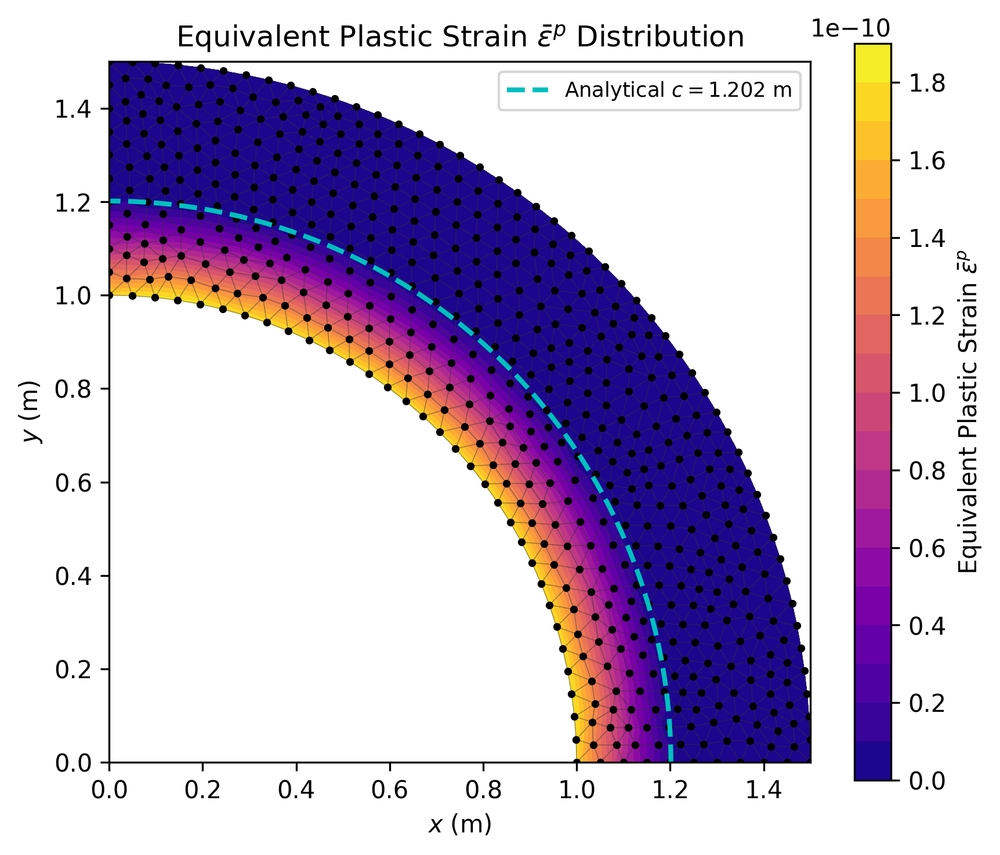

# Modernized 2D Elastoplastic BEM (ELQUABE-EP2D)

This repository contains a modernized Fortran 90 implementation of the **2D Elastoplastic Boundary Element Method (BEM)**, combining the quadratic boundary element architecture of **ELQUABE** (*Brebbia & Dominguez, 1992*) with the 2D initial-stress elastoplastic domain-cell formulation of **BEMECH** (*Gao & Davies, 2001*).

The solver models two-dimensional (**Plane Strain** and **Plane Stress**) elastic and elastoplastic problems using 3-node quadratic boundary elements (`line3`) and 6-node triangular (`triangle6`) or 8-node serendipity quadrilateral (`quad8`) internal cells.

---

## 🔄 Program Architecture & Workflow

### 1. Global Program Flowchart (`ELQUABE`)



### 2. Detailed Non-Linear Elastoplastic Execution (`NL_COEFS` & `NL_SOLVE`)



---

## 🚀 Key Features

1. **2D Initial-Stress Elastoplastic BEM Formulation**:
   - Solves the Somigliana boundary and interior displacement/stress integral equations coupled with domain integrals of the initial plastic stress tensor $\sigma_{ij}^p$:
     $$\mathbf{A}_b \Delta \mathbf{X}_b = \mathbf{E}_b \Delta \boldsymbol{\sigma}^p, \qquad \Delta \mathbf{u}_{\text{int}} = \mathbf{A}_u \Delta \mathbf{X}_b + \mathbf{E}_u \Delta \boldsymbol{\sigma}^p, \qquad \Delta \boldsymbol{\sigma}^e = \mathbf{A}_\sigma \Delta \mathbf{X}_b + \mathbf{E}_\sigma \Delta \boldsymbol{\sigma}^p$$
   - Eliminates boundary unknowns in memory via $\mathbf{A}_c = \mathbf{A}_b^{-1} \mathbf{E}_b$ (`SLNPD_MULTI` using LAPACK `DGESV`), forming the coupled plastic influence matrices $\mathbf{E}_{ui} = \mathbf{E}_u + \mathbf{A}_u \mathbf{A}_c$ and $\mathbf{E} = \mathbf{E}_\sigma + \mathbf{A}_\sigma \mathbf{A}_c$.
   - Supports **Plane Strain (`NSIG = 4`)** and **Plane Stress (`NSIG = 3`)**.

2. **Quadratic Internal Domain Cells (`NODC = 6` and `NODC = 8`)**:
   - Supports **6-node quadratic triangular cells (`triangle6`)** and **8-node quadratic quadrilateral cells (`quad8`)**.
   - **Regular & Nearly-Singular Cells (`ADAPTINT_CELL_2D`)**: Distance-based adaptive Gauss-Legendre quadrature order selection (`CHOSEGP_1D`) with automatic uniform sub-triangle ($N_{\text{sub}}^2$) or sub-quadrilateral subdivision.
   - **Singular Cells (`SIN_CELL_2D` & `CELL_BOUND_2D`)**: Polar/Duffy degenerate sub-element coordinate transformation for weakly singular $E_{ijk}$ kernels (`NTU = 4`) and strongly singular Cauchy principal value $E_{ijkl}$ kernels (`NTU = 5`) combined with analytical free terms $F_{ijkl}$ and outer cell-side line integrals.

3. **Natural Corner Traction Discontinuity Without Duplicate Nodes**:
   - Unlike legacy codes that require duplicate corner nodes (`MULTP`), this code retains the element-wise traction vector `DFI(6*NE)` and explicit boundary element connectivity `CONEC(NE, 3)`, naturally handling traction discontinuities at geometric corners while maintaining a single unique set of boundary nodes (`1..N`) and internal nodes (`N+1..N+L`).

4. **General Yield Criteria & Hardening Laws**:
   - Built-in support for four classical yield criteria (`PL_FLOW` & `DF_DSIG`):
     - `NCRIT = 1`: **Tresca**
     - `NCRIT = 2`: **von Mises**
     - `NCRIT = 3`: **Mohr–Coulomb**
     - `NCRIT = 4`: **Drucker–Prager**
   - Supports elastic–perfectly plastic materials as well as isotropic hardening (`HARDI`), kinematic hardening (`HARDK` with back-stress tensor `BACKS`), and mixed hardening (`EM`).

5. **OpenMP Parallelization & In-Memory Linear Algebra**:
   - Boundary matrix assembly (`GHMATEQ`), internal point evaluation (`INTEREQ`), and 2D domain cell integration (`INT_CELL_2D`) are parallelized with **OpenMP**.
   - All influence matrices ($\mathbf{A}_b, \mathbf{A}_u, \mathbf{A}_\sigma, \mathbf{E}_b, \mathbf{E}_u, \mathbf{E}_\sigma, \mathbf{A}_c, \mathbf{E}_{ui}, \mathbf{E}$) are stored directly in RAM (zero scratch-disk I/O overhead).
   - Enforces **64-bit double precision** (`-fdefault-real-8`) and uses **LAPACK (`DGESV`)** for both single-RHS and multi-RHS linear systems.

6. **Near-Singularity Treatment & Boundary Stress Recovery**:
   - Hyperbolic sine ($\sinh$) coordinate transformation (`SINHTRANS`, *Johnston & Elliott, 2005*) for nearly-singular boundary integrals.
   - Full Cauchy stress tensor ($\sigma_x, \tau_{xy}, \sigma_y, \sigma_z$) and initial plastic stress coupling (`BSCOEF`, `PBSCOEF`) recovered directly on boundary nodes via local normal–tangential shape function derivatives.

7. **Python Pre/Post-Processing, Analytical Lamé–Hill Validation & VTK Export**:
   - `input_data.py` & `preproc.py`: Read Gmsh quadratic meshes (`.msh`) via `meshio`, map boundary and internal cell connectivities, decompose normal boundary pressures (`type_x = 2`) into global nodal tractions, plot the mesh and boundary conditions (`geometry.png`), and generate `eq12cb.dat`.
   - `posproc.py`: Compares numerical BEM results against the **analytical elastoplastic Lamé–Hill solution** for a thick-walled cylinder under internal pressure (`result_plot.png`), exports `.vtk` files (`resultado_elquabe.vtk`) for ParaView, and generates 2D contour maps of radial displacement (`displacement_map.png`), von Mises equivalent stress (`von_mises_map.png`), and equivalent plastic strain (`plastic_strain_map.png`).

---

## 📂 Project Structure

### Fortran Source Code
- `main.f90`: Main program entry point (`INPUTEQ` $\rightarrow$ `GHMATEQ` $\rightarrow$ `SLNPD` $\rightarrow$ `INTEREQ` $\rightarrow$ `NL_COEFS` $\rightarrow$ `NL_SOLVE` $\rightarrow$ `OUTPTEQ`).
- `data_mod.f90`: Global variable declarations, boundary and cell connectivity arrays (`CONEC`, `LNDC`), elastoplastic state arrays (`ESTRS`, `BACKS`, `EPSTN`, `DFDS`), influence matrices, and dynamic memory management (`allocate_arrays`, `allocate_plastic_arrays`, `deallocate_arrays`).
- `io_mod.f90`: Input/Output routines (`INPUTEQ`, `OUTPTEQ`), reading boundary elements, internal points, 2D internal cells (`NODC = 6` or `8`), and plasticity parameters, and exporting results.
- `assembly_mod.f90`: Elastic boundary integration (`GHMATEQ`, `EXTINEQ`, `LOCINEQ`, `INTEREQ`, `SIGMAEQ`), 2D domain cell integration (`NL_COEFS`, `INT_CELL_2D`, `ADAPTINT_CELL_2D`, `SIN_CELL_2D`, `CELL_BOUND_2D`, `EVAL_KE_2D`), and incremental-iterative elastoplastic solver (`NL_SOLVE`, `FORM_PLASTIC_MATRICES`, `P_M_ITER`, `SIG_SCALE`, `SIGCROSS`, `PL_FLOW`, `DF_DSIG`, `DF_MATRX`, `UPDATEV`).
- `solver_mod.f90`: LAPACK `DGESV` wrappers for single-RHS (`SLNPD`) and multi-RHS (`SLNPD_MULTI`) systems.

### Python Scripts & Mesh Files
- `input_data.py`: Problem configuration, elastic properties ($E, \nu$), boundary conditions, and plasticity dictionary (`nsig`, `tolgp`, `nauto`, `ncrit`, `uniax`, `frict`, `hardi`, `hardk`, `em`, `nincs`, `fincr`, `miter`, `toler`).
- `preproc.py`: Gmsh mesh reader, cell connectivity mapper, boundary condition builder, and `eq12cb.dat` generator.
- `posproc.py`: Analytical Lamé–Hill elastoplastic cylinder validation, error computation, VTK exporter, and 2D contour plotter.
- `fluxogram.py`: Graphviz script that generates the program workflow diagrams (`diagrama_graphviz.png` and `diagrama_nl_graphviz.png`).
- `Run_elquabe_plastic_on_Colab.ipynb`: Google Colab notebook for running the complete 2D elastoplastic BEM pipeline in the cloud.
- `placa.geo` / `placa.msh`: Gmsh geometry and quadratic mesh (`50` `line3` boundary elements, `459` internal nodes, and `254` `triangle6` internal cells) for the quarter thick-walled cylinder under internal pressure.

### Output Data Files
- `eq12cb.out`: Complete formatted report (mesh, boundary conditions, cell connectivity, plasticity convergence log, nodal displacements, tractions, stresses, and equivalent plastic strains).
- `dpbou.dat` / `dpint.dat`: Boundary and internal nodal displacements (`u_x`, `u_y`, `|u|`).
- `stbou.dat` / `stint.dat`: Boundary and internal nodal stresses and plastic strains in 5 columns (`sigma_x`, `tau_xy`, `sigma_y`, `sigma_vm`, `epstn`).
- `resultado_elquabe.vtk`: VTK unstructured grid with nodal vector/scalar fields (`Displacement`, `Sigma_X`, `Tau_XY`, `Sigma_Y`, `Von_Mises_Stress`, `Equivalent_Plastic_Strain`).

---

## ⚙️ Compilation & Build

### Requirements
- **GFortran** (GCC) with **OpenMP** (`libgomp`)
- **LAPACK & BLAS** libraries
- **Python 3** with `numpy`, `scipy`, `matplotlib`, `meshio`, and `graphviz`

On Windows with MSYS2 (`UCRT64`):
```bash
pacman -S mingw-w64-ucrt-x86_64-gcc-fortran mingw-w64-ucrt-x86_64-lapack mingw-w64-ucrt-x86_64-make mingw-w64-ucrt-x86_64-graphviz
```

### Building the Executable
Run `build.bat` on Windows or `make` on Linux/MSYS2:
```powershell
.\build.bat
```
This compiles `data_mod.f90`, `io_mod.f90`, `solver_mod.f90`, `assembly_mod.f90`, and `main.f90` with `-fopenmp -O3 -fdefault-real-8 -Wall -Wextra -static` and links against `-llapack -lblas` to generate `elquabe_modern.exe`.

---

## 🏃 Usage & Validation Pipeline

1. **Preprocess the Mesh & Plasticity Parameters**:
   ```bash
   python preproc.py
   ```
   *Generates `eq12cb.dat` and `geometry.png`.*

2. **Run the 2D Elastoplastic BEM Solver**:
   ```bash
   ./elquabe_modern.exe
   ```
   *Assembles elastic and domain-cell matrices in parallel, solves the incremental-iterative elastoplastic system, and writes `eq12cb.out`, `dpbou.dat`, `dpint.dat`, `stbou.dat`, and `stint.dat`.*

3. **Post-Process & Compare Against Analytical Solution**:
   ```bash
   python posproc.py
   ```
   *Computes relative $L_2$ errors against the Lamé–Hill analytical elastoplastic solution and generates `result_plot.png`, `displacement_map.png`, `von_mises_map.png`, `plastic_strain_map.png`, and `resultado_elquabe.vtk`.*

---

## 📊 Benchmark Validation: Thick-Walled Cylinder Under Internal Pressure

For a quarter thick-walled cylinder ($a = 1.0\text{ m}$, $b = 1.5\text{ m}$, $E = 70\text{ GPa}$, $\nu = 0.3$) subjected to internal pressure $P = 10.0\text{ Pa}$ in **Plane Strain (`NSIG = 4`)** with a **von Mises** yield stress $\sigma_Y = 24.0\text{ Pa}$ (`NCRIT = 2`, elastic–perfectly plastic):

- **Analytical Elastic–Plastic Interface Radius**: $c = 1.2015\text{ m}$
- **Convergence**: 18 load increments, converging in 3 iterations per increment ($\text{RERR} < 10^{-6} < \text{TOLER} = 10^{-5}$)

| Field Quantity | Global Relative $L_2$ Error (559 Nodes) |
| :--- | :---: |
| Radial Displacement $u_r(r)$ | **$0.44\%$** ($4.44 \times 10^{-3}$) |
| Radial Stress $\sigma_r(r)$ | **$0.48\%$** ($4.77 \times 10^{-3}$) |
| Hoop Stress $\sigma_\theta(r)$ | **$0.58\%$** ($5.83 \times 10^{-3}$) |
| Equivalent von Mises Stress $\sigma_{\text{vM}}(r)$ | **$0.35\%$** ($3.45 \times 10^{-3}$) |

### 2D Domain Contour Maps & Mesh

| Mesh & Boundary Conditions | Radial Displacement $u_r$ |
| :---: | :---: |
|  |  |
| **von Mises Equivalent Stress $\sigma_{\text{vM}}$** | **Equivalent Plastic Strain $\bar{\varepsilon}^p$** |
|  |  |

### Analytical Lamé–Hill vs. 2D Elastoplastic BEM Profiles


---

## 📖 References

* **Gao, X.-W., & Davies, T. G.** (2001). *Boundary Element Programming in Mechanics*. Cambridge University Press.
* **Brebbia, C. A., & Dominguez, J.** (1992). *Boundary Elements: An Introductory Course*. Computational Mechanics Publications & McGraw-Hill.
* **Hill, R.** (1950). *The Mathematical Theory of Plasticity*. Oxford University Press.
* **Johnston, P. R., & Elliott, D.** (2005). *A sinh transformation for evaluating nearly singular boundary element integrals*. International Journal for Numerical Methods in Engineering, 62(4), 564–578.
